# PRD: AcoustiSolar — Low-Cost Solar Panel Micro-Crack Detection Using Acoustic Emission

| Field | Value |
|---|---|
| Document version | 1.0 (initial full draft) |
| Date | 15 Nov 2026 |
| Status | Ready for engineering review |
| Product type | Simulation-first software platform + edge-ready ML + cloud analytics (hardware-ready, not hardware-dependent) |
| Working name | **AcoustiSolar** (rename freely) |

> **How to read this document.** Numbers marked **[TARGET]** are goals to be validated, **[ASSUMPTION]** are planning assumptions to be confirmed, and **[CALIBRATE]** are physical parameters that must be tuned against real measurements. Nothing marked this way should be presented to customers or investors as a proven fact.

---

## 1. Executive Summary

Micro-cracks in silicon PV cells are among the most common causes of hidden power loss in modules. They are created during manufacturing, transport, installation, hail, wind and thermal cycling, and many are invisible to the eye. Today they are found mostly with **electroluminescence (EL) imaging**, which is accurate but needs dark conditions or powered equipment, trained operators, and per-module inspection. That makes continuous, fleet-wide monitoring impractical.

**Acoustic Emission (AE)** offers an alternative: a crack that initiates or grows releases a burst of elastic stress waves, which travel through the glass and laminate and can be picked up by cheap piezoelectric (PZT) discs bonded to the module. A handful of sensors, a small amplifier/ADC chain and an ML model can in principle *detect, locate and grade* cracking events continuously.

**AcoustiSolar is a platform that makes this approach buildable and provable in software first:**

1. A **multi-fidelity physics simulator** (a "digital twin" of a PV module + sensors + low-cost electronics) that generates large, labeled, physically realistic AE datasets.
2. A **signal-processing + ML engine** for event detection, noise rejection, source localization, crack-type classification and severity scoring, trained on simulation and fine-tuned on real data.
3. An **edge inference package** (quantized models + reference firmware spec) targeting a sub-US$25 per-module sensing node **[TARGET]**.
4. A **cloud platform** (ingestion, time-series storage, 3D module health maps, fleet analytics, alerts, reports, APIs).
5. A **validation framework** that quantifies sim-to-real gaps and produces auditable performance evidence.

**Why this can be a high-value product.** The defensible assets are (a) the calibrated simulator and the synthetic-data pipeline (hard to replicate), (b) the trained models and the accumulating real-world labeled AE corpus, and (c) the fleet analytics layer. Hardware is a commodity; data and models are the moat.

---

## 2. Problem Statement and Opportunity

### 2.1 Problem
- Micro-cracks reduce power through cell-area isolation, increased series resistance and hot-spot risk, and they propagate over time under thermal cycling and mechanical load.
- EL and IR inspection are periodic, labor-heavy and offline-biased; they give a snapshot, not a trend.
- Industrial AE equipment (sensors, multi-channel DAQ, software) is too expensive to deploy per module.

### 2.2 Opportunity hypothesis **[ASSUMPTION — validate in Phase 0 customer discovery]**
- Utility-scale owners/O&M firms, module manufacturers (end-of-line and transport QA), insurers/lenders (due diligence) and bankable-asset buyers (secondary market) all pay to know module condition.
- Value is highest where it is **cheaper to monitor than to re-inspect**, and where early detection avoids warranty disputes.
- The initial wedge is **not** continuous fielded monitoring of every module (cost-prohibitive); it is **sampled monitoring + QA/transport/installation stress testing + lab/OEM validation**, expanding to fleet sentinel modules (1 monitored module per string/array block).

### 2.3 Target users / personas
| Persona | Need | Primary surface |
|---|---|---|
| **Module QA engineer (OEM / EPC)** | Detect cracking during handling, lamination, flash test, transport & mechanical-load tests | Lab/Line dashboard, reports |
| **O&M / asset manager** | Prioritize inspections, track crack growth, justify claims | Fleet dashboard, alerts, API |
| **Reliability / R&D scientist** | Understand crack mechanics, design sensor layouts, test algorithms | Simulation studio, notebooks, SDK |
| **ML engineer / data scientist** | Train, benchmark, deploy models | Experiment tracking, dataset registry |
| **Hardware/firmware engineer** | Choose sensors, ADC rates, thresholds; validate on target MCU | DAQ digital twin, firmware-in-the-loop |
| **Investor / evaluator** | See provable performance | Benchmark & validation reports |

---

## 3. Scope

### 3.1 In scope (v1)
- Crystalline-silicon (mono/poly, PERC/TOPCon/HJT half-cut and full-cell) glass–backsheet and glass–glass modules.
- Passive AE (crack initiation/growth) **and** active ultrasonic probing mode (see §4.2).
- Multi-fidelity wave simulation, synthetic data factory, ML models, edge export, cloud platform, validation suite.
- Reference sensing-node specification and BOM; firmware-in-the-loop via emulation.

### 3.2 Out of scope (v1)
- Manufacturing our own hardware at volume (reference design + partners only).
- Thin-film (CdTe/CIGS) modules, flexible modules, bifacial-specific optics.
- Power-loss quantification from electrical IV curves (integration hooks provided, not a core model).
- Certification as a standards-compliant inspection method (roadmap item).

### 3.3 Non-goals
- Replacing EL imaging as the gold-standard for labeling. EL is used as **ground truth** for real-data validation.

---

## 4. Scientific Premise and Constraints (read before building)

### 4.1 What AE can and cannot do
- **AE detects *active* damage processes** (crack initiation, growth, friction between crack faces). A static, stable crack is silent in passive mode.
- Consequently the product supports **stimulation modes** that make cracks "talk":
  1. **Thermal transients** (sunrise/sunset, cloud transients, thermal cycling chamber).
  2. **Mechanical loading** (IEC 61215-style static/dynamic mechanical load, transport vibration, handling).
  3. **Active probing** (a PZT used as a pulser; others listen). A static crack changes transmission/reflection, giving a *pulse-echo/attenuation fingerprint*. This extends capability to static cracks and is a major differentiator.

### 4.2 Operating modes
| Mode | Description | Detects |
|---|---|---|
| **P — Passive AE** | Continuous or triggered listening | New/growing cracks, crack-face friction |
| **A — Active ultrasonic** | Low-duty-cycle pulses, compare to baseline | Existing cracks via transmission loss, mode conversion, scattering |
| **H — Hybrid** | P with periodic A baselines | Both; enables crack-growth trending |

### 4.3 Physical model essentials **[CALIBRATE all values]**
- **Waveguide:** the 3.2 mm front glass (≈72 GPa, ≈2500 kg/m³) is the dominant acoustic path. In the 50–400 kHz range, fundamental Lamb modes **S0** (≈5 km/s, weakly dispersive at low frequency-thickness) and **A0** (strongly dispersive, slower) dominate.
- **Layers:** glass / EVA (soft, highly damping, temperature-dependent modulus) / Si cells ≈ 160–200 µm with metallization / EVA / backsheet or glass. EVA viscoelasticity is the key attenuation and temperature-sensitivity driver.
- **Source:** brittle micro-fracture in silicon is modeled as a moment-tensor (dipole) source with a short rise time; spectrum is broadband with energy typically in the 100 kHz–1 MHz range **[CALIBRATE]**; low-cost sensing captures the lower portion.
- **Environment noise:** rain/hail impacts, wind-driven frame rattle, thermal ticking of frames/mounts, tracker motors, inverter EMI, insects/birds, handling. This is the dominant false-alarm source in the field; the noise model is a first-class simulation component.
- **Localization:** TDOA from a 4-sensor array; at 1 MSPS a sample is ≈5 mm of S0 travel; sub-sample cross-correlation interpolation should push resolution below that **[TARGET]**.

---

## 5. System Architecture

### 5.1 Logical architecture

```mermaid
flowchart LR
  subgraph SIM[Simulation & Data Factory]
    A[Module Twin Config\nlayers, cells, sensors, EVA T-dependence]
    B[Source Library\ncrack types, moment tensors, noise events]
    C1[Tier 0: Analytical\nLamb dispersion + ray/TDOA]
    C2[Tier 1: GPU FDTD/Spectral\nJAX/CuPy 2.5D-3D]
    C3[Tier 2: High-fidelity FEM/SEM\nvalidation only]
    D[DAQ Twin\nPZT response, preamp, filter, ADC, jitter]
    E[(Dataset Registry\nZarr + Parquet + DVC)]
    A --> C1 & C2 & C3
    B --> C1 & C2 & C3
    C1 & C2 & C3 --> D --> E
  end
  subgraph ML[ML & Signal Engine]
    F[Preprocessing\nfilter, denoise, trigger]
    G[Models\ndetect/classify/localize/severity]
    H[Training & Eval\nsim-to-real, uncertainty]
    I[Export\nONNX, TFLite-Micro, int8]
    E --> F --> G --> H --> I
  end
  subgraph EDGE[Edge Node]
    J[Firmware\nTrigger + feature + tiny model]
    K[MQTT/HTTPS uplink]
    I --> J --> K
  end
  subgraph CLOUD[Cloud Platform]
    L[Ingest API/Broker]
    M[(TimescaleDB + S3/MinIO)]
    N[Inference Service]
    O[Fleet Analytics & Alerts]
    P[Web App + 3D Health Map]
    K --> L --> M --> N --> O --> P
    M --> H
  end
```



### 5.2 Architectural principles
1. **Simulation-first, hardware-ready.** Every hardware stage (sensor, preamp, filter, ADC, MCU trigger logic) has a software twin with identical interfaces to the real thing; real data drops into the same pipelines.
2. **Multi-fidelity.** Cheap models generate millions of samples; expensive models calibrate and validate the cheap ones. Never train on a single fidelity without a measured fidelity gap.
3. **Physics-in-the-loop ML.** Use physics priors (TDOA geometry, mode velocities, dispersion) as features/constraints, not only black-box learning.
4. **Reproducibility.** Every dataset is a function of (config hash, code version, seed). Every model is traceable to a dataset version.
5. **Edge/cloud split.** Edge handles trigger + compression + coarse classification (power-limited); cloud handles heavy localization, trending, retraining.
6. **Uncertainty everywhere.** Every prediction ships with calibrated confidence; low-confidence events are routed for human review/active learning.

### 5.3 Recommended deployment topology
- **Dev/Research:** workstation with NVIDIA GPU, Docker Compose.
- **Scale simulation/training:** Kubernetes cluster with GPU node pool (cloud or on-prem), Ray for distributed jobs.
- **Production SaaS:** managed Kubernetes, managed Postgres/Timescale, object storage, CDN for the web app, regional data residency options.

---

## 6. Technology Stack (decisions with rationale)

| Layer | Primary choice | Why | Alternatives considered |
|---|---|---|---|
| **Core language** | Python 3.12 | Scientific/ML ecosystem | Julia (fast sim, smaller ecosystem) |
| **Fast numerics / sim kernels** | **JAX** (GPU/TPU, autodiff, vmap for batched sims); CuPy/Numba for custom kernels | Differentiable wave solver enables source inversion, parameter calibration by gradient, and massive batching | PyTorch custom ops, C++/CUDA (later optimization), Devito |
| **High-fidelity wave solver (validation tier)** | **COMSOL or Abaqus explicit** (commercial, quickest to trusted results) *or* open-source **SPECFEM3D Cartesian** / **FEniCSx (dolfinx)** | Independent verification of Tier 1 | Elmer, deal.II, k-Wave (acoustic only, not elastic plates) |
| **Dispersion / modes** | Custom **SAFE** (semi-analytical FE) solver for multilayer laminates + Lamb-wave analytic for plates | Fast, exact modal content for multilayer glass/EVA/cell stack | Disperse (commercial) for cross-check |
| **Signal processing** | SciPy, `ObsPy` (waveform I/O, picking, travel-time utilities borrowed from seismology), PyWavelets, `librosa` for STFT utils | Mature waveform tooling | MATLAB (not open) |
| **ML framework** | **PyTorch 2.x + PyTorch Lightning**; `torchaudio`; Hydra for configs | Flexibility, community | JAX/Flax (use for physics-informed parts) |
| **Models** | 1D-CNN/ResNet-1D, Conformer-lite/small Transformer for waveforms, CNN on CWT scalograms, GNN or set-transformer for multi-sensor fusion, MLP/gradient-boost for edge tier | See §9 | XGBoost/LightGBM baselines (always keep as sanity baselines) |
| **Edge ML** | **TFLite Micro / CMSIS-NN** (int8) via ONNX → TFLite; **ExecuTorch** as option | MCU-friendly | Edge Impulse (rapid prototyping), microTVM |
| **MCU target (reference)** | ARM Cortex-M4/M7 class (e.g., STM32G4/H7 family) or RP2350 + external SAR ADC; ESP32-S3 for connectivity variant **[ASSUMPTION — final BOM in Phase 3]** | Cost, DSP instructions, simultaneous-sampling ADC options | nRF for BLE-only |
| **Firmware language** | C/C++ (CMSIS-DSP) with optional Rust (Embassy) | Determinism, ecosystem | Zephyr RTOS as the OS layer |
| **Firmware-in-the-loop** | **Renode** (full-system MCU emulation), Unity/Ceedling tests | Run real firmware against simulated waveforms in CI | QEMU |
| **Data formats** | **Zarr** (waveform arrays), **Parquet** (events/metadata), HDF5 import/export | Chunked, cloud-native, fast | NetCDF |
| **Dataset/experiment mgmt** | **DVC** (data versioning), **MLflow** (experiments/model registry), Weights & Biases optional | Reproducibility | LakeFS |
| **Distributed compute** | **Ray** (sim sweeps, hyperparameter search), Kubernetes | Elastic scaling | Dask, Slurm |
| **Backend API** | **FastAPI** (Python), Pydantic v2, gRPC for internal high-throughput paths | Same language as ML, async | Go for ingest gateway if throughput requires |
| **Ingest broker** | **MQTT (EMQX)** from edge → **Redpanda/Kafka** for stream processing | MQTT suits constrained devices; Kafka for durable pipeline | NATS JetStream |
| **Databases** | **PostgreSQL + TimescaleDB** (metadata, time-series, event tables), **S3/MinIO** (raw waveforms), **Redis** (cache/queues), **pgvector** (waveform embeddings for similarity search) | One relational core, great time-series | ClickHouse for analytics at massive scale |
| **Frontend** | **Next.js + TypeScript + React**, Tailwind, **Three.js / react-three-fiber** (3D module & wave animation), **uPlot/Plotly** (waveforms, spectrograms), deck.gl (fleet map) | Rich, performant visuals | Streamlit for internal tools only |
| **Auth** | OIDC via **Keycloak** (or Auth0), RBAC + org multi-tenancy | Enterprise SSO readiness | |
| **Infra / DevOps** | Docker, Kubernetes (Helm), Terraform, GitHub Actions/ArgoCD, OpenTelemetry + Prometheus + Grafana + Loki | Standard, auditable | |
| **Quality** | pytest, hypothesis (property-based tests for physics invariants), ruff, mypy, pre-commit, Playwright (e2e) | | |
| **Docs** | MkDocs Material + Jupyter Book for validation reports | | |

**Language split recommendation:** Python for ~85% (sim orchestration, ML, backend), TypeScript for web, C/C++ for firmware, optional CUDA/Rust for hot paths after profiling.

---

## 7. Simulation Engine (the core intellectual property)

### 7.1 Goals
- Generate physically plausible, **labeled** AE waveforms for any module geometry, crack, sensor layout and DAQ configuration.
- Quantify how design decisions (sensor count/position, ADC rate, filter band, threshold) change detection/localization performance **before** building hardware.
- Provide a differentiable path for **source inversion** and **parameter calibration** against real measurements.

### 7.2 Fidelity tiers

| Tier | Method | Speed | Use |
|---|---|---|---|
| **T0** | Analytical Lamb/SAFE dispersion + frequency-domain propagation (dispersion-aware Green's function) + attenuation model + ray TDOA | ~ms/event | Millions of samples, design-space sweeps, ML pretraining |
| **T1** | GPU finite-difference or spectral-element elastic wave solver, 2.5D (plate + layered effective media) and 3D for local cell detail; JAX-based, batched | ~0.1–5 s/event on GPU | Primary training data, crack-geometry effects, reflections from frame/cells/busbars |
| **T2** | Commercial/open FEM or SEM with full 3D laminate (cells, ribbons, solder, EVA viscoelasticity), crack-face contact | minutes–hours/event | Verification & calibration of T1/T0 only |

**Requirement:** fidelity gap (T0 vs T1 vs T2) on arrival-time, amplitude and spectral centroid must be reported and tracked per release (§7.6).

### 7.3 Module Twin parameters (randomized for domain robustness)
- **Geometry:** 60/72/78-cell and half-cut layouts, glass thickness 2.0–4.0 mm, frame type, busbar count (5–16 BB/MBB), cell size (M6/M10/G12), glass–glass vs glass–backsheet.
- **Materials:** glass E/ρ/ν; EVA/POE storage & loss modulus vs temperature (−20 to 85 °C) and frequency; Si anisotropy (cubic, orientation); backsheet type; adhesive/coupling layer thickness.
- **Sensors:** PZT disc diameter/thickness, bonded position, coupling quality (couplant/epoxy), frequency response (resonant + wideband), directivity, sensitivity spread ±dB, sensor aging.
- **Boundary/environment:** frame boundary reflections, mounting clamp damping, temperature gradient, humidity effect on EVA.

### 7.4 Source Library (labels come from here)
| Class | Physical description | Label outputs |
|---|---|---|
| Crack initiation | Burst moment-tensor source, orientation relative to cell | x, y, cell id, orientation, energy |
| Crack growth | Sequence of bursts with clustering and increasing energy | trajectory, rate |
| Crack-face friction | Low-energy stick-slip, repeated at a loaded crack | active friction flag |
| Crack types | Dendritic, diagonal, parallel-to-busbar (finger-interruption), multi-direction, cell edge/corner chipping, busbar-solder fracture | type label, estimated length |
| **Noise sources** | Rain/hail impact, wind rattle, frame thermal ticking, handling taps, EMI bursts, white/colored noise, tracker motor, impulsive electrical glitches | noise class (hard negatives) |
| Active pulses | Pulser waveforms (tone burst, chirp) with and without cracks | transmission loss, echo features |

### 7.5 DAQ Twin (what makes this "low-cost aware")
- Sensor transfer function → preamp (gain, bandwidth, input noise density) → bandpass/anti-alias filter → ADC (bit depth 10–16, sample rate 250 kSPS–2 MSPS, jitter, channel skew, quantization, clipping) → trigger logic (threshold, hysteresis, dead time, pre-trigger buffer) → data packetization.
- Sweep objective: **find the cheapest hardware configuration that meets the performance KPIs** (cost-performance Pareto frontier). This output is a flagship feature.

### 7.6 Verification & Validation (V&V) plan for the simulator
1. **Verification (solving the equations right):** grid/time-step convergence, energy conservation, comparison vs analytical Lamb dispersion curves, vs SAFE, vs T2 FEM on benchmark plates.
2. **Validation (solving the right equations):** compare with **real lab measurements**: pencil-lead-break (Hsu-Nielsen) source on a real module (standard AE reference source, cf. ASTM E976/E1106 practice), measured group velocities, attenuation vs distance, spectral content, reflection signatures.
3. **Calibration loop:** gradient-based/Bayesian fit of EVA damping, coupling, sensor response to measured data; store calibrated "twin parameter sets" per module type with uncertainty.
4. **Acceptance [TARGET]:** T1 arrival-time error < 3% and spectral-centroid error < 15% vs measured on at least 3 module types; otherwise sim data may not be used for production model training without domain adaptation.

### 7.7 Differentiable simulation use-cases (premium capability)
- Source localization by waveform inversion (back-propagation/time reversal) as an ML-independent baseline.
- Optimal sensor placement via gradient/Bayesian optimization.
- Auto-calibration of material parameters from a single pencil-break test.

---

## 8. Data Architecture

### 8.1 Data entities
`Organization → Site → Array → String → Module → SensorNode → Sensor → Event → Waveform`, plus `Dataset`, `SimRun`, `ModelVersion`, `Inspection (EL ground truth)`, `Alert`.

### 8.2 Waveform event record (Zarr + Parquet index)
```
event_id: uuid
module_id: str
node_id: str
t_trigger_utc: timestamp(ns)
sample_rate_hz: float
n_channels: int (typically 4)
pre_trigger_samples, total_samples: int
waveforms: int16[n_channels, N]      # raw ADC counts, + gain/offset calibration
channel_skew_ns: float[n_channels]
temperature_c, irradiance_wm2, wind_ms, rain_flag: optional context
trigger_features: {peak_amp, rise_time, duration, counts, energy, centroid_freq}
mode: P|A|H
label (sim/GT only): {class, x_mm, y_mm, cell_id, crack_type, energy, severity}
provenance: {sim_tier, config_hash, code_sha, seed} | {device_fw, hw_rev}
```

### 8.3 Dataset tiers
| Dataset | Content | Size target [TARGET] |
|---|---|---|
| **SYN-A** | T0 pretraining corpus | 10⁷ events |
| **SYN-B** | T1 high-realism training | 10⁶ events |
| **SYN-C** | T2 verification set | 10³ events |
| **LAB-1** | Pencil-break & controlled loading on real modules, with EL before/after | ≥ 20 modules |
| **FIELD-1** | Sentinel-module field data with EL audits | ≥ 50 modules, ≥ 6 months |
| **NOISE-1** | Field noise-only recordings (rain, wind, thermal) for hard negatives | continuous |

### 8.4 Data governance
- Versioned with DVC; immutable dataset snapshots; schema evolution via Pydantic/JSON-Schema; per-tenant data isolation; configurable retention (raw waveforms 90 days hot, then compressed/cold).

---

## 9. Signal Processing and ML Engine

### 9.1 Tasks
1. **Event detection & trigger optimization** (is this a real AE hit vs. noise?).
2. **Event classification:** {crack initiation, growth, friction, rain/hail, wind/rattle, thermal tick, EMI, handling, unknown}.
3. **Localization:** (x, y) position on the module, cell ID, with uncertainty ellipse.
4. **Crack-type & severity estimation:** type + relative energy/length proxy; cumulative AE energy per cell.
5. **Active-mode analysis:** baseline comparison → per-path damage index → crack map by tomography.
6. **Health scoring & trending:** per-cell and per-module crack-activity score; growth-rate forecasting; remaining-useful-life proxy (research-grade, flagged as such).

### 9.2 Pipeline
```
Raw ADC → calibrate (gain/offset/skew) → bandpass (e.g., 50–400 kHz, config) → denoise (wavelet / learned)
→ trigger & windowing → onset picking (AIC / STA-LTA / learned picker)
→ features (classic AE: amplitude, rise time, duration, counts, energy, centroid, partial power bands;
           time-frequency: CWT/STFT; modal: S0/A0 energy ratio)
→ model(s) → calibrated probabilities + localization + uncertainty → event store
```

### 9.3 Model families (progressive complexity)
| Stage | Model | Purpose |
|---|---|---|
| **Baseline** | STA/LTA + threshold; classic features + LightGBM | Always-on benchmark; edge fallback |
| **Detection/classification** | 1D-ResNet / Conformer-lite on 4-channel waveform; CNN on scalograms | Main classifier |
| **Localization** | (a) Classical TDOA + least squares with dispersion correction; (b) ML regressor on cross-correlation features; (c) **Physics-informed hybrid:** neural network corrects classical estimate (residual learning) | Accuracy + explainability |
| **Fusion** | Set-transformer / small GNN over sensors (invariant to sensor count/layout changes) | Layout generalization |
| **Self-supervised** | Masked-waveform or contrastive pretraining on unlabeled real data | Reduce labeling need |
| **Anomaly/novelty** | Autoencoder or Mahalanobis-on-embedding | Detect unseen noise/new failure modes |
| **Edge** | Distilled, int8 quantized CNN (< 100 KB flash, < 50 ms inference on Cortex-M7 **[TARGET]**) | Cheap on-node triage |

### 9.4 Training strategy
1. **Pretrain on SYN-A** (diverse, cheap) → **train on SYN-B** (realistic) → **fine-tune on LAB-1/FIELD-1** (real).
2. **Domain randomization** of all twin parameters (§7.3) plus augmentation (gain, noise, channel dropout, time shifts, clipping).
3. **Domain adaptation** (adversarial/MMD) and **few-shot calibration** on a single module via pencil-break test.
4. **Hard-negative mining** from NOISE-1 to control false-alarm rate.
5. **Calibration of probabilities** (temperature scaling, conformal prediction) for trustworthy alerts.
6. **Active learning loop:** low-confidence field events → review UI → label → retrain.

### 9.5 Evaluation protocol
- **Splits by module/physical configuration**, not by random event (prevents leakage). Keep a **held-out "unseen module type"** set.
- **Metrics:**
  - Detection: recall at fixed false-alarm rate (FAR per module-day), PR-AUC.
  - Classification: macro-F1, confusion matrix, expected calibration error (ECE).
  - Localization: median/90th-pct error (mm), cell-ID accuracy.
  - Severity: rank correlation with EL-derived crack length/area.
  - Edge: latency, energy per inference, flash/RAM.
- **Sim-to-real report:** every model release includes performance on SYN (held-out), LAB, FIELD and the gap between them.

### 9.6 Explainability
Saliency on waveforms/scalograms, arrival-time overlay, "why this alert" panel citing features (e.g., S0 arrival-time residual, spectral centroid), nearest-neighbor similar past events.

---

## 10. Edge Node (Reference Design — hardware-ready)

### 10.1 Reference concept **[ASSUMPTION; finalize in Phase 3]**
- 4 PZT discs (diameter selected for ~100–250 kHz response), bonded at module corners/edges with low-cost adhesive/couplant.
- Per-channel low-noise preamp + bandpass (≈ 50–400 kHz), 4-channel simultaneous sampling ≥ 1 MSPS, 12–16 bit.
- MCU with DMA ring-buffer, threshold + pre-trigger capture, on-node feature extraction, tiny classifier.
- Uplink: LoRaWAN/NB-IoT for events/features (low bandwidth); Wi-Fi/Ethernet/RS-485 for optional raw-waveform upload; PV-powered or small supercap/battery.
- **BOM target:** < US$25/node at 10k volume **[TARGET — requires supplier quotes]**.

### 10.2 Firmware requirements
- Ring buffer with pre-trigger, deterministic timing, channel-skew calibration.
- Adaptive threshold (noise-floor tracking, temperature compensation).
- Feature packet (~64–256 bytes/event) + optional compressed raw window (on request or on high confidence).
- Secure boot, signed OTA updates, device identity (X.509 or PSK).
- Watchdog, power-fail logging, health telemetry (noise floor, sensor coupling check via self-test pulse).
- **Sensor coupling self-test** using active pulse (detects de-bonded sensors — critical for field reliability).

### 10.3 Firmware-in-the-loop in CI
Renode emulation replays simulated waveforms into the firmware ADC peripheral; CI asserts trigger timing, feature outputs and classification equivalence with Python reference within tolerance.

---

## 11. Cloud Platform and Product Surface

### 11.1 Backend services
| Service | Responsibility |
|---|---|
| **Ingest Gateway** | MQTT/HTTPS intake, device auth, schema validation, backpressure |
| **Stream Processor** | Dedup, enrich (weather/irradiance), route to inference |
| **Inference Service** | Model serving (ONNX Runtime / Triton), batching, versioning, canary rollout |
| **Localization Service** | TDOA + hybrid models, uncertainty |
| **Analytics Service** | Cell-level crack-activity scoring, trend/forecast, anomaly detection |
| **Simulation Service** | Run sim jobs from UI/API (queue → Ray/K8s GPU) |
| **Dataset/Model Registry** | DVC/MLflow-backed APIs |
| **Alerting** | Rules + ML-driven; email/SMS/Slack/webhook/CMMS integration |
| **Reporting** | PDF/CSV reports (QA certificates, O&M reports) |
| **Admin/Tenant** | Orgs, RBAC, audit logs, billing hooks |

### 11.2 Web application modules
1. **Fleet Overview:** map/hierarchy, health heat, alert counts, trends.
2. **Module Detail (flagship UI):** 3D/2D module with cell grid; event markers with uncertainty ellipses; time slider ("replay how cracks developed"); per-cell AE energy; EL image overlay when available.
3. **Event Explorer:** waveforms, spectrograms, picks, features, model explanations, similar-event search, labeling tools.
4. **Simulation Studio:** configure module/sensor/DAQ, place a crack, **animate the wave field**, view synthetic signals as the DAQ would see them, run sweeps (sensor layout, ADC rate, filters), export datasets.
5. **Design Optimizer:** cost–performance Pareto plot for hardware configurations.
6. **Model Lab:** experiments, metrics, confusion matrices, sim-to-real gap dashboards, one-click export to edge format.
7. **Validation Center:** calibration workflows (pencil-break wizard), twin parameter sets, V&V reports.
8. **Alerts & Reports.**
9. **Admin/Settings/API keys.**

### 11.3 Public API and SDK
- REST + WebSocket (live events), OpenAPI spec; Python SDK (`pip install acoustisolar`) for simulation, dataset access and model evaluation.
- Webhooks; CSV/Parquet export; SCADA/CMMS connectors (OPC-UA, Modbus bridge, SAP PM / Maximo via integration partners — roadmap).

Example event API:
```http
POST /v1/ingest/events
{
  "node_id": "N-00421", "t_trigger_utc": "2026-11-15T06:42:11.123456Z",
  "sample_rate_hz": 1000000, "mode": "P",
  "features": {"peak_amp_mv": 84.2, "rise_us": 12.4, "duration_us": 310, "energy_au": 5.1e3, "centroid_khz": 148},
  "context": {"temp_c": 31.2, "irradiance": 640, "wind_ms": 2.1},
  "waveform_url": "s3://.../evt_...zarr"        // optional
}
```

---

## 12. Functional Requirements

Priority: **P0** = MVP-critical, **P1** = needed for commercial launch, **P2** = differentiator/later.

### 12.1 Simulation
| ID | Requirement | Pri |
|---|---|---|
| SIM-01 | Configure a module twin (layers, geometry, materials, cell layout) via YAML/JSON and UI | P0 |
| SIM-02 | Tier-0 analytical simulator producing 4-channel waveforms for a given crack position/type | P0 |
| SIM-03 | Tier-1 GPU solver with batched execution; reproducible by seed | P0 |
| SIM-04 | Source library per §7.4 with labels | P0 |
| SIM-05 | DAQ twin per §7.5 (sensor, preamp, filter, ADC, trigger) | P0 |
| SIM-06 | Domain randomization framework with documented parameter priors | P0 |
| SIM-07 | Tier-2 import/export adapters (COMSOL/Abaqus/SPECFEM) for verification | P1 |
| SIM-08 | EVA temperature/frequency-dependent viscoelastic model | P1 |
| SIM-09 | Sensor-placement and hardware-config optimizer (Pareto output) | P1 |
| SIM-10 | Differentiable calibration/inversion workflows | P2 |
| SIM-11 | Wave-field animation export (video/WebGL) | P1 |
| SIM-12 | Active-mode (pulse–echo/transmission) simulation | P1 |

### 12.2 Data & ML
| ID | Requirement | Pri |
|---|---|---|
| ML-01 | Dataset generation CLI + job API; DVC-versioned snapshots | P0 |
| ML-02 | Baseline detector + classifier (classic features + GBM) | P0 |
| ML-03 | Deep detector/classifier (1D-CNN/ResNet) | P0 |
| ML-04 | Classical TDOA localization with dispersion correction | P0 |
| ML-05 | Hybrid/learned localization with uncertainty | P1 |
| ML-06 | Layout-invariant multi-sensor fusion model | P1 |
| ML-07 | Probability calibration + conformal intervals | P1 |
| ML-08 | Self-supervised pretraining pipeline | P2 |
| ML-09 | Domain adaptation & few-shot module calibration | P1 |
| ML-10 | Int8 export + benchmark on MCU emulator and reference board | P1 |
| ML-11 | Active learning loop with labeling UI | P2 |
| ML-12 | Automated sim-to-real gap report per model release | P0 |
| ML-13 | Severity/trend forecasting | P2 |
| ML-14 | Active-mode tomography damage map | P2 |

### 12.3 Platform
| ID | Requirement | Pri |
|---|---|---|
| PLT-01 | Device/ingest API with authentication and schema validation | P0 |
| PLT-02 | Event storage (Timescale + object store) and query API | P0 |
| PLT-03 | Module Detail view with event map and waveform viewer | P0 |
| PLT-04 | Simulation Studio UI (run, visualize, export) | P1 |
| PLT-05 | Fleet dashboard, alerts, notifications | P1 |
| PLT-06 | Multi-tenant RBAC, SSO, audit log | P1 |
| PLT-07 | PDF/CSV reporting & QA certificate template | P1 |
| PLT-08 | OTA firmware management | P2 |
| PLT-09 | Python SDK and public API docs | P1 |
| PLT-10 | Replay/time-lapse of crack development | P1 |
| PLT-11 | Integration connectors (SCADA/CMMS) | P2 |
| PLT-12 | On-prem / air-gapped deployment bundle | P2 |

### 12.4 Edge
| ID | Requirement | Pri |
|---|---|---|
| EDG-01 | Reference firmware spec + simulator-verified reference implementation | P1 |
| EDG-02 | Trigger/feature extraction bit-exact vs. Python reference | P1 |
| EDG-03 | Tiny-model inference on MCU within budget | P1 |
| EDG-04 | Sensor coupling self-test | P1 |
| EDG-05 | Secure OTA and device identity | P2 |

---

## 13. Non-Functional Requirements

| Category | Requirement |
|---|---|
| **Performance (sim)** | T0 ≥ 1,000 events/s/GPU; T1 ≥ 5 events/s/GPU for 1.0×1.7 m module at target resolution **[TARGET]** |
| **Performance (cloud)** | Ingest ≥ 5,000 events/s sustained per cluster; p95 inference latency < 300 ms; UI interaction < 100 ms for waveform pan/zoom of 1 M samples |
| **Scalability** | Horizontal scale to 100k modules / 10⁹ stored events with tiered storage |
| **Reliability** | 99.9% API availability; no data loss on ingest (at-least-once with idempotency); edge store-and-forward ≥ 72 h |
| **Reproducibility** | Bit-reproducible sim runs on same hardware/seed; dataset hash recorded |
| **Security** | TLS 1.3 everywhere, per-device identity, encryption at rest, RBAC, audit logs, secrets in vault, SBOM and dependency scanning, signed firmware. Target SOC 2 readiness |
| **Privacy/Compliance** | Tenant isolation, data-residency options, GDPR-aligned retention/export/delete |
| **Observability** | Tracing/metrics/logs for every service; model-drift monitors (input distribution, noise floor, prediction entropy) |
| **Usability** | New user runs a first simulation in < 10 minutes; accessibility WCAG 2.1 AA |
| **Maintainability** | ≥ 85% test coverage on core libraries; typed Python; documented public APIs |
| **Portability** | Linux/macOS dev; containers for everything; CPU fallback for sim T0 and inference |

---

## 14. Success Metrics (KPIs and Acceptance Criteria)

### 14.1 Technical **[TARGET — adjust after Phase 1 baseline]**
| Metric | Simulation (held-out) | Real lab (LAB-1) | Real field (FIELD-1) |
|---|---|---|---|
| Event detection recall @ FAR ≤ 1 per module-day | ≥ 98% | ≥ 92% | ≥ 85% |
| Crack vs. noise classification macro-F1 | ≥ 0.95 | ≥ 0.88 | ≥ 0.80 |
| Localization median error | ≤ 1.5 cm | ≤ 3 cm | ≤ 5 cm |
| Localization 90th-pct error | ≤ 4 cm | ≤ 8 cm | ≤ 12 cm |
| Cell-ID accuracy | ≥ 95% | ≥ 85% | ≥ 75% |
| Severity rank correlation vs. EL | — | ρ ≥ 0.7 | ρ ≥ 0.6 |
| Calibration (ECE) | ≤ 0.05 | ≤ 0.08 | ≤ 0.10 |
| Sim-to-real degradation on detection recall | — | ≤ 10 pts | ≤ 15 pts |

### 14.2 Product/Business **[TARGET]**
- Simulation: 3 distinct module types calibrated to V&V acceptance (§7.6).
- Edge: model fits within flash/RAM/latency budget; reference BOM < US$25.
- Pilot: ≥ 2 paying/LOI pilots, ≥ 1 independent validation (university/test lab) confirming performance claims.
- Platform: ≥ 99.9% uptime in pilot; time-to-first-insight for a new site < 1 day.

### 14.3 Definition of Done (per release)
Tests green, V&V benchmarks within tolerance, sim-to-real report generated, model card published, security scan clean, docs updated, reproducible build tagged.

---

## 15. Standards, Compliance and Scientific Rigor

- Align test practices with **IEC 61215** (module design qualification: thermal cycling, mechanical load, hail) for stimulation protocols.
- Use AE practice standards for sensor mounting/response and reference sources (e.g., **ASTM E650, E976, E1106** families) for calibration methodology.
- Treat **EL imaging (IEC TS 60904-13 family)** as ground truth for real-data labeling; document labeling protocol and inter-rater agreement.
- Publish a **model card** and **datasheet for datasets** (known limitations, domain coverage).
- Consider peer-reviewed publication of the simulator V&V and benchmark results to build credibility.
- Safety: sensors are passive, low-voltage; active pulser voltage limited (e.g., ≤ 20 V) and isolated **[ASSUMPTION]**; no modification of module electrical circuitry; installation guidance for roof/field work.

---

## 16. Engineering Plan

### 16.1 Monorepo layout
```
acoustisolar/
├─ packages/
│  ├─ physics/          # SAFE, Lamb, T0/T1 solvers, materials, sources (JAX)
│  ├─ daqtwin/          # sensor/preamp/ADC/trigger models
│  ├─ dsp/              # filters, pickers, features, TDOA
│  ├─ ml/               # datasets, models, training, eval, export
│  ├─ sdk/              # public Python SDK
│  └─ schemas/          # Pydantic/JSON-Schema/OpenAPI single source of truth
├─ services/
│  ├─ ingest/  inference/  localization/  analytics/  simulation/  reporting/  admin/
├─ apps/
│  ├─ web/              # Next.js app
│  └─ docs/
├─ firmware/
│  ├─ core/ (C/C++), hal/, tests/ (Ceedling), renode/
├─ validation/          # V&V suites, benchmark notebooks, reference data
├─ infra/               # Terraform, Helm, Docker, ArgoCD
├─ data/ (DVC pointers)
└─ .github/workflows/
```

### 16.2 Engineering practices
- Trunk-based development, protected main, mandatory reviews on `physics/` and `schemas/`.
- **Physics unit tests:** reciprocity, energy conservation, dispersion-curve match, time-reversal consistency, mesh/time-step convergence.
- **ML tests:** data-leakage checks, deterministic seeds, golden-set regression, calibration regression.
- **Contract tests** between firmware ↔ ingest API ↔ SDK from shared schemas.
- **Nightly:** full benchmark suite, sim-to-real gap report, drift simulation.
- **MLOps:** MLflow registry with staged promotion (Staging → Shadow → Canary → Prod); automatic rollback on KPI regressions; shadow-mode inference for new models.

### 16.3 Build vs. buy
| Capability | Decision |
|---|---|
| Wave solver T1, DAQ twin, ML models, fusion/localization | **Build** (core IP) |
| High-fidelity FEM (T2) | **Buy/Use** (COMSOL/Abaqus license or SPECFEM) for verification |
| Auth, broker, DB, observability | **Use** open-source/managed |
| Labeling UI | Build thin layer; consider Label Studio integration |
| Hardware manufacturing | **Partner** (EMS/ODM) |

---

## 17. Roadmap

| Phase | Duration **[ASSUMPTION]** | Deliverables | Exit criteria |
|---|---|---|---|
| **0 — Foundations & Discovery** | 4–6 wks | Literature review of PV micro-crack AE; customer interviews; lock KPIs; repo/CI/infra skeleton; select module types | KPIs agreed; 10+ interviews; lab-access plan |
| **1 — Simulation Core (MVP-Sim)** | 3 mo | T0 + T1 solvers, DAQ twin, source library, dataset CLI, baseline ML detector/classifier, TDOA localization; V&V benchmark v1 | Verified vs analytical dispersion; baseline meets sim KPIs; reproducible datasets |
| **2 — ML Engine + Studio** | 3 mo | Deep models, fusion, calibration, uncertainty, Simulation Studio UI, hardware Pareto optimizer, active-mode sim | Sim KPIs in §14.1 met; design-optimizer demo; edge export prototype |
| **3 — Real-world Validation** | 4–6 mo | Lab rig (modules + PZT + commercial AE reference), pencil-break calibration, LAB-1 dataset with EL, sim calibration, domain adaptation, reference node prototype | LAB-1 KPIs met; fidelity gap report; BOM validated |
| **4 — Platform & Pilot** | 4–6 mo | Cloud platform GA-beta, fleet dashboard, alerts, reports, OTA, security hardening; 2–3 pilot sites; FIELD-1 begins | Pilot uptime ≥ 99.9%; field FAR target in range |
| **5 — Commercial Launch & Scale** | ongoing | SaaS tiers, integrations, SOC 2, certification path, active-mode tomography, forecasting | Paying customers; independent validation published |

**Total to commercial pilot:** ~15–20 months with a funded team **[ASSUMPTION]**.

**Critical-path insight:** real-data access (Phase 3) is the biggest schedule and credibility risk. Start procuring modules, lab access and an AE reference system in Phase 0/1 in parallel.

---

## 18. Team and Budget (planning-level, **[ASSUMPTION]**)

### 18.1 Core team
| Role | FTE |
|---|---|
| Technical lead / architect | 1 |
| Computational physicist (wave propagation, FEM/SEM, SAFE) | 2 |
| ML engineers (signals, physics-informed, edge) | 2–3 |
| Backend/platform engineers | 2 |
| Frontend/visualization engineer (3D, scientific UI) | 1–2 |
| Embedded/firmware + hardware engineer | 1–2 |
| NDT/AE domain expert (advisor → hire) | 1 |
| PV reliability scientist / lab technician | 1 |
| DevOps/MLOps | 1 |
| Product manager / designer | 1 |

### 18.2 Cost drivers
GPU compute for sim/training; COMSOL/Abaqus licenses (or open-source engineering time); lab setup (modules, commercial AE system as reference, environmental chamber access, EL camera); field pilot logistics; cloud infrastructure; security/compliance audits.

---

## 19. Risks and Mitigations

| # | Risk | Likelihood | Impact | Mitigation |
|---|---|---|---|---|
| R1 | **Sim-to-real gap** larger than expected (EVA damping, coupling variability, boundary reflections) | High | High | Multi-fidelity V&V; calibration from pencil-break; domain randomization; few-shot adaptation; early lab data |
| R2 | **Passive AE misses static cracks** | High | High | Hybrid/active mode; stimulation protocols; position product as "active crack-activity + change detection" |
| R3 | **Field noise → false alarms** (rain, wind, thermal, EMI) | High | High | NOISE-1 corpus; hard-negative mining; multi-sensor consistency (physical-propagation check); context features; conformal abstention |
| R4 | **Low-cost sensor variability / bonding degradation** | Med | High | Self-test pulse; sensor-health telemetry; sensitivity-spread randomization; relative (not absolute) amplitude features |
| R5 | **Ground-truth scarcity/quality** | High | High | EL before/after each load step; labeling protocol; weak labels from physics; partnerships with labs/OEMs |
| R6 | **Localization degradation due to dispersion/attenuation/EVA temperature** | Med | Med | Dispersion-corrected TDOA; temperature-aware velocity; learned residual correction |
| R7 | **Edge compute/power limits** | Med | Med | Tiered inference; simple trigger + features on edge; heavy models in cloud |
| R8 | **Market adoption/pricing** | Med | High | Wedge into QA/transport/test labs first; pilot ROI studies; flexible licensing |
| R9 | **IP/competition** (EL drones, AI on EL images, vibration/acoustic startups) | Med | Med | Patent filings on hybrid method/twin pipelines; continuous-monitoring differentiator; data moat |
| R10 | **Solver cost/complexity overruns** | Med | Med | Tiered fidelity; JAX batching; profile and optimize; use T2 only for verification |

---

## 20. Business Model and Go-To-Market **[ASSUMPTION — validate]**

### 20.1 Offerings
1. **AcoustiSolar Studio (SaaS/enterprise license):** simulation + dataset + model lab for OEMs, labs and researchers.
2. **AcoustiSolar QA:** line/transport/test-lab monitoring package (hardware reference + software subscription + certificates).
3. **AcoustiSolar Fleet:** sentinel-module monitoring with analytics, alerts and API.
4. **Data & model licensing, calibrated twin parameter sets, and professional services** (sensor-layout design, validation campaigns).

### 20.2 Pricing hypotheses
- Studio: per-seat + compute credits; QA: per-site + per-module-tested; Fleet: per-monitored-module/month. Pricing to be set after pilot ROI data (value = avoided re-inspection cost + warranty claim support + earlier intervention).

### 20.3 GTM sequence
1. Research/lab partnerships (credibility + data) → 2. OEM/EPC QA pilots → 3. O&M fleet sentinels → 4. Insurers/financiers (risk scoring).

---

## 21. Open Questions (please answer; defaults are used if unanswered)

1. **Hardware:** Is the end goal a *physical product* (we design reference hardware) or *software/IP only*? Default: software + simulation first, reference hardware spec later.
2. **Real data access:** Do you have (or can you get) real PV modules, an AE sensor/DAQ, or lab/university access? Default: assume lab access arrives in Phase 3.
3. **Module type focus:** Which module formats first (60-cell mono PERC, half-cut, glass–glass)? Default: 60/120 half-cut mono PERC, glass–backsheet.
4. **Operating mode priority:** Passive only, or include active ultrasonic probing from the start? Default: both; passive first.
5. **Target market first:** Manufacturer QA, transport/installation, or O&M fleet monitoring? Default: QA/test-lab wedge.
6. **Compute/budget constraints:** GPU availability (local vs cloud) and licensed FEM tools? Default: open-source stack with one commercial FEM license for verification.
7. **Deployment:** Cloud SaaS only, or on-prem/air-gapped required? Default: cloud SaaS, on-prem as P2.
8. **Team/timeline:** Solo, small team, or funded team? Timeline in §17 assumes a funded team of ~10–12.
9. **Is this an academic/prototype deliverable, a startup product, or both?** Affects emphasis on publication vs. productization.

---

## 22. Appendices

### A. Glossary
- **AE:** Acoustic Emission. **Lamb waves:** guided elastic waves in plates (modes S0, A0, …). **TDOA:** Time Difference Of Arrival. **EVA:** ethylene-vinyl acetate encapsulant. **EL:** electroluminescence imaging. **PZT:** lead zirconate titanate piezoceramic. **SAFE:** Semi-Analytical Finite Element method. **FDTD/SEM:** finite-difference time-domain / spectral element method. **FAR:** false-alarm rate. **ECE:** expected calibration error. **Hsu-Nielsen source:** pencil-lead break used as a standard AE reference source.

### B. Example simulation config (YAML)
```yaml
module:
  layout: {cells: 120, half_cut: true, cell_size: M10, busbars: 9}
  stack:
    - {name: glass, thickness_mm: 3.2, E_gpa: 72, rho: 2500, nu: 0.22}
    - {name: eva_front, thickness_mm: 0.45, model: viscoelastic_prony, T_c: 25}
    - {name: si_cell, thickness_um: 175, anisotropic: true}
    - {name: eva_back, thickness_mm: 0.45}
    - {name: backsheet, thickness_mm: 0.30}
sensors:
  count: 4
  positions_mm: [[60,60],[60,1640],[980,60],[980,1640]]
  disc: {diameter_mm: 10, resonance_khz: 200, sensitivity_spread_db: 3}
daq:
  preamp: {gain_db: 40, noise_nv_rthz: 5, band_khz: [50, 400]}
  adc: {bits: 12, rate_hz: 1000000, jitter_ns: 20, skew_ns: 50}
  trigger: {threshold_mv: 20, pre_samples: 512, post_samples: 2048, dead_time_us: 500}
source:
  type: crack_initiation
  position: {mode: random_in_cell}
  moment_tensor: {rise_time_us: [0.5, 3], energy_log10: [-1, 2]}
noise:
  classes: [rain, wind_rattle, thermal_tick, emi_burst, handling]
  mix_ratio: 0.5
randomization: {seed: 42, profile: wide_v1}
```

### C. Localization reference (pseudo-code)
```python
def locate(waveforms, sensor_xy, fs, v_s0, band):
    x = bandpass(waveforms, band, fs)
    t = [pick_onset(x[i]) for i in range(len(sensor_xy))]       # AIC / learned picker
    dt = [t[i] - t[0] for i in range(1, len(t))]                 # sub-sample via xcorr interpolation
    # least-squares hyperbolic positioning; v_s0 temperature-corrected; dispersion-corrected arrival
    pos, cov = solve_tdoa(sensor_xy, dt, v_s0, robust=True)
    return pos, cov                                               # cov -> uncertainty ellipse
```

### D. First 30-day engineering backlog (kick-off)
1. Finalize KPIs & module types; set up monorepo, CI, DVC, MLflow, dev containers.
2. Implement Lamb/SAFE dispersion for glass–EVA–Si–EVA–backsheet; verify against plate analytics.
3. Implement T0 propagation + DAQ twin + 4-channel TDOA baseline; first end-to-end synthetic dataset (10⁵ events).
4. Baseline classifier + localizer with metrics dashboard.
5. Draft T1 JAX solver (2D plate with absorbing boundaries); convergence tests.
6. Literature/standards checklist and lab-test protocol (pencil-break matrix, loading steps, EL schedule).
7. Customer-discovery interview script and target list.

---

*End of PRD v1.0*